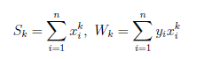
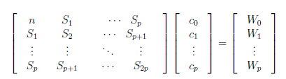
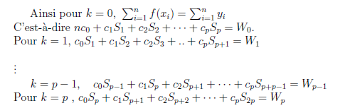
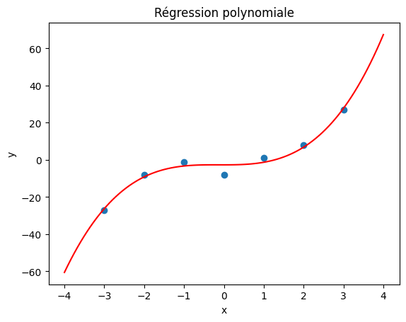

# Modèle de régression polynomiale

Ce projet implémente une régression polynomiale à partir de données simples afin de modéliser une relation non linéaire entre une variable d'entrée x et une variable de sortie y.

L'objectif est de retrouver un polynôme qui passe au plus près des points observés, puis d'utiliser ce modèle pour estimer des valeurs supplémentaires.

## Description du projet

Le notebook `regression.ipynb` contient une implémentation complète en Python avec :

- une construction manuelle du système linéaire associé à la régression polynomiale,
- le calcul des coefficients du polynôme par résolution de matrice,
- le calcul d'un coût (erreur quadratique moyenne sur une version normalisée),
- une visualisation de la courbe ajustée sur les données.

## Données utilisées

Le projet s'appuie sur le jeu de données suivant :

```python
x = np.array([-3, -2, -1, 0, 1, 2, 3])
y = np.array([-27, -8, -1, -8, 1, 8, 27])
```

On cherche à approximer ces valeurs par un polynôme de degré adapté, détecté automatiquement à partir de la variation de la tendance.

## Méthode

Le modèle repose sur la formulation générale :

P(x) = c0 + c1 x + c2 x² + ... + cn x^n

Les coefficients sont calculés en résolvant un système de la forme :

S * C = W

avec :

- S : matrice des sommes de puissances de x,
- W : vecteur des contributions de y * x^j,
- C : vecteur des coefficients du polynôme.

### Méthode des moindres carrés

L'idée centrale est de choisir les coefficients du polynôme de sorte que la somme des écarts au carré entre les valeurs observées et les valeurs prédites soit minimale. Autrement dit, on cherche à minimiser :

S = Σ (yi - P(xi))²

Cela donne les formules suivantes :

- S_k = Σ xi^k
- W_k = Σ yi * xi^k

où k correspond à la puissance de x utilisée dans le modèle.



En écrivant les équations pour chaque puissance, on obtient un système linéaire. La matrice du système contient les sommes de puissances de x, et le second membre contient les sommes pondérées par y.



Ce système se développe ainsi :

- pour k = 0 : c0 + c1 S1 + c2 S2 + ... + cp Sp = W0
- pour k = 1 : c0 S1 + c1 S2 + c2 S3 + ... + cp S_{p+1} = W1
- ...
- pour k = p : c0 S_p + c1 S_{p+1} + c2 S_{p+2} + ... + cp S_{2p} = W_p



La fonction `calcul_degree` détermine automatiquement le degré du modèle selon les changements de tendance dans le jeu de données. Ensuite, la courbe est tracée et une prédiction peut être réalisée pour n'importe quel point.

## Prérequis

Assurez-vous d'avoir Python installé ainsi que les bibliothèques suivantes :

```bash
numpy
matplotlib
```

## Installation

```bash
pip install -r requirements.txt
```

## Utilisation

Pour lancer le notebook :

```bash
jupyter notebook regression.ipynb
```

Ou exécuter les cellules du notebook dans VS Code / Jupyter Notebook.

## Résultat attendu

Le programme produit un graphique de type :

- points expérimentaux en bleu,
- courbe de régression polynomiale en rouge,
- titre : "Régression polynomiale".



La sortie console affiche également une estimation du coût du modèle ainsi qu'une prédiction pour un point donné, par exemple :

```text
Coût de la régression : 3.0476
La prédiction pour le point 10 est : ...
```
